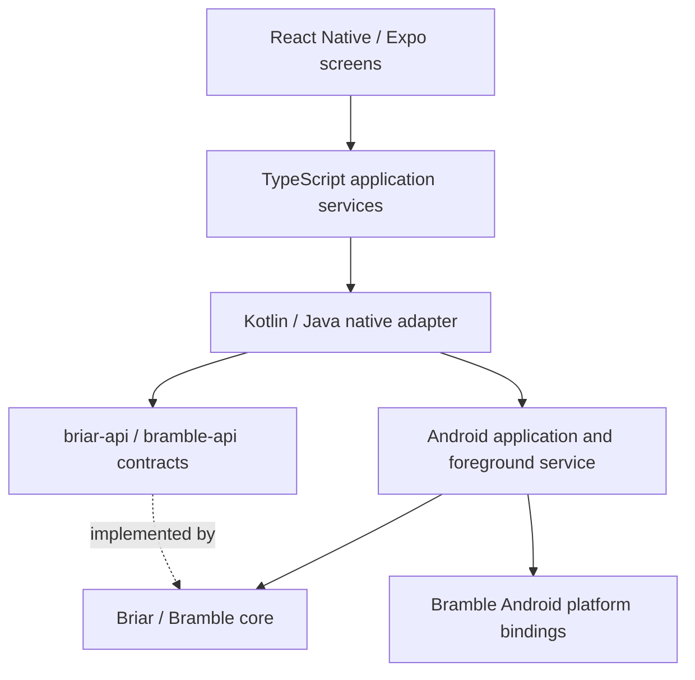

# Android migration architecture

The first milestone adds an independently installed Expo development build in `briar-expo/`. Its Kotlin adapter reports the Android API level. The original APK remains the operational client. The application/service integration and feature migrations are subsequent milestones.

The diagram shows the target. The probe currently terminates in Android's OS API and establishes Expo module autolinking and the JS-to-Kotlin call boundary.

## Gradle project map

| Project | Direct production project dependencies | Responsibility |
| --- | --- | --- |
| bramble-api | — | Shared account, database, crypto, transport, event and lifecycle contracts |
| bramble-core | bramble-api (API) | Encrypted database, crypto, sync, transport sessions, protocol validation and plugin management |
| bramble-android | bramble-api, bramble-core | Android account, network, radio and scheduling bindings, Tor and Lyrebird binaries |
| bramble-java | bramble-core | JVM platform bindings for the headless client |
| briar-api | bramble-api | Briar feature contracts and events |
| briar-core | briar-api (API), bramble-core | Messaging, attachments, groups, forums, blogs, invitations, introductions, mailbox client and removable-drive workflows |
| briar-android | bramble-api, bramble-core, bramble-android, briar-core | APK, Dagger composition root, service, Android entry points and legacy presentation |
| briar-headless | bramble-core, bramble-java, briar-core | Independent JVM host and HTTP API, with its own Dagger composition and lifecycle |
| mailbox-integration-tests | bramble-api, bramble-core, mailbox-core, mailbox-lib (test scope) | Exercises mailbox client/server interoperability |
| briar-mailbox submodule | mailbox-android and mailbox-lib consume mailbox-core. mailbox-cli consumes mailbox-core and mailbox-lib. | Independent mailbox server app and JVM host. Root settings include mailbox-core and mailbox-lib only when integration tests are enabled. |
| briar-expo | Its own Expo Gradle project and the local BriarFoundation module | Hosts the React Native development shell under a separate Android application ID |

Gradle test fixtures and external library dependencies are outside the table. See the root [settings.gradle](../settings.gradle) and each module's `build.gradle`. Root build tooling owns the upstream dependency checksums. Keep Expo Gradle and NPM dependency changes scoped to the development shell.

## Android runtime ownership

| Area | Existing owners and behavior | Migration boundary |
| --- | --- | --- |
| Dagger and initialization | `BriarApplicationImpl` attaches the localized base context, creates `DaggerAndroidComponent` with `AppModule`, initializes eager singletons in Bramble core, Bramble Android, Briar core and Android order, and installs logging and exception handling. `ActivityComponent` creates scoped UI dependencies. | Keep one application graph per client process. Audit eager initialization and secondary process behavior before embedding React in the operational host. |
| Startup and account | `SplashScreenActivity` sets preference defaults and selects startup or expiry. Startup routes first-time users to setup. Setup creates the account. `StartupActivity`/`StartupViewModel` handle password entry, database open and service readiness. `LockManagerImpl` and `UnlockActivity` gate the UI separately from sign-out. | Native session state and the account manager own authorization and database keys. Screens reflect readiness, lock, startup failure and sign-out state. |
| Foreground service | `BriarControllerImpl` binds activities to `BriarService`. The service posts a connected-device foreground notification, starts `LifecycleManager` with the database key, reports readiness/failure and handles shutdown and receiver cleanup. `DozeWatchdogImpl`, alarms and wake locks support background work. | Tie JS subscriptions to their UI lifetime. Give the native host ownership of the service across React reload, activity recreation, backgrounding and process restart. |
| Tor and internet | `AndroidTorPluginFactory` supplies Android Tor wiring. Bramble owns the Tor plugin and transport sessions. The Android Gradle build extracts pinned Tor and Lyrebird artifacts. `AndroidNetworkManager` supplies connectivity state. | Expose status and settings through native calls. Keep Tor and its transport data path inside Bramble. |
| Bluetooth and Wi-Fi | `AndroidBluetoothPlugin` owns Bluetooth connections. `AndroidLanTcpPlugin` handles LAN transport. Nearby contact and Bluetooth reconnect screens own camera/radio permission and discovery flows. The hotspot manager plus local web server serve the offline app sharing flow. | Retain the Bluetooth, LAN and hotspot implementations and the permission and radio-state checks. Present discovery and status through RN. |
| Permissions and Android intents | The client manifest declares foreground-service, network, camera, notification, boot, battery optimization, biometric and nearby/location permissions with applicable API gates. Bramble Android contributes Bluetooth, network and wake permissions. `IntentRouter` handles `briar:` links and shared text. QR, file and media workflows use Android permission and URI handoffs. | Audit merged manifests and validate external input before routing into RN. Preserve exported-component policy and keep activity-result/URI grants tied to the host lifecycle. |
| Notifications | `AndroidNotificationManagerImpl` observes native events and owns channels, counts, content intents and suppression. `NotificationCleanupService` and `SignInReminderReceiver` handle cleanup and boot/update reminders. | Keep channel and PendingIntent behavior in the host and resolve navigation only after the account gate. |
| Sensitive UI and errors | `ScreenFilterMonitorImpl`, `TapSafeFrameLayout`, `BaseActivity` window flags, lock/unlock and the panic responder enforce device policies. Crash and startup failure activities have separate manifest-declared processes. | Keep panic validation, hide/exit/delete, overlay defenses and failure recovery independent of JS startup. |
| Settings and data | `SettingsManager`, settings stores, mailbox manager and transport settings govern persisted configuration. Attachment helpers handle Android media and content URIs. | Expose only the operations each screen needs. Avoid copying persisted settings or sensitive material into JS storage. |

The [class inventory](android-class-inventory.md) names the audited Android sources. The [parity inventory](feature-parity.md) tracks the behavior and tests attached to the screens and Android entry points.

## Integration sequence

1. Build and launch the isolated Expo shell and verify the Kotlin probe on a physical phone.
2. Introduce a typed adapter against the existing application graph. Resolve host and build integration in a separate change. Preserve original install, upgrade and manifest behavior.
3. Migrate workflows individually behind native entry points, with the original client serving as a peer and behavior reference.
4. Remove legacy presentation only after its workflows, handoffs and failure paths have device coverage.
